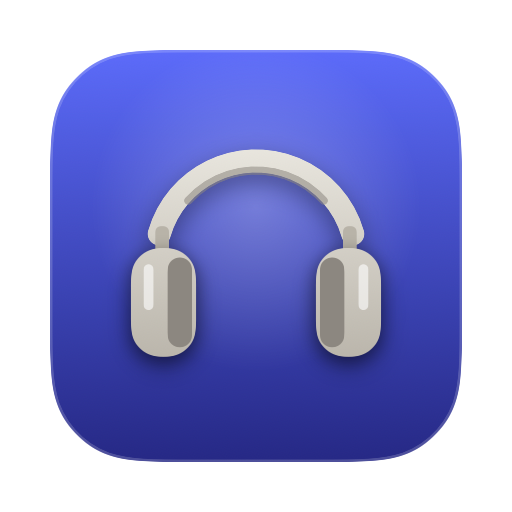
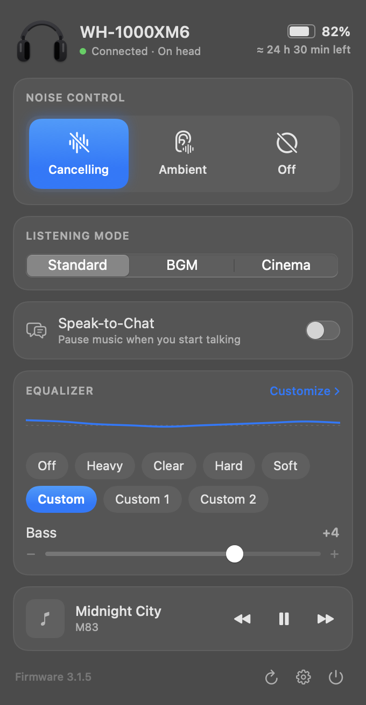
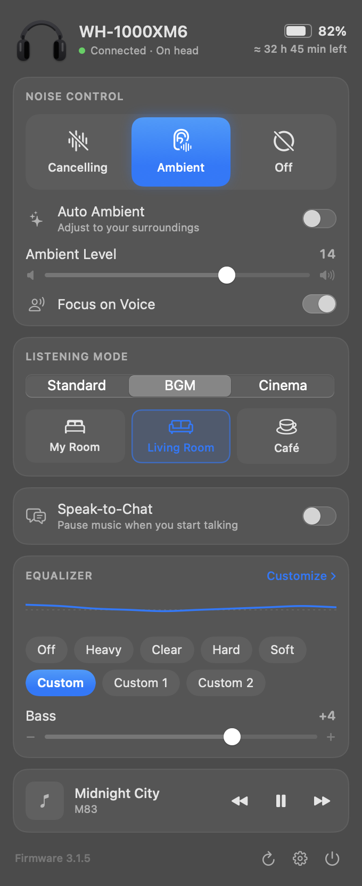
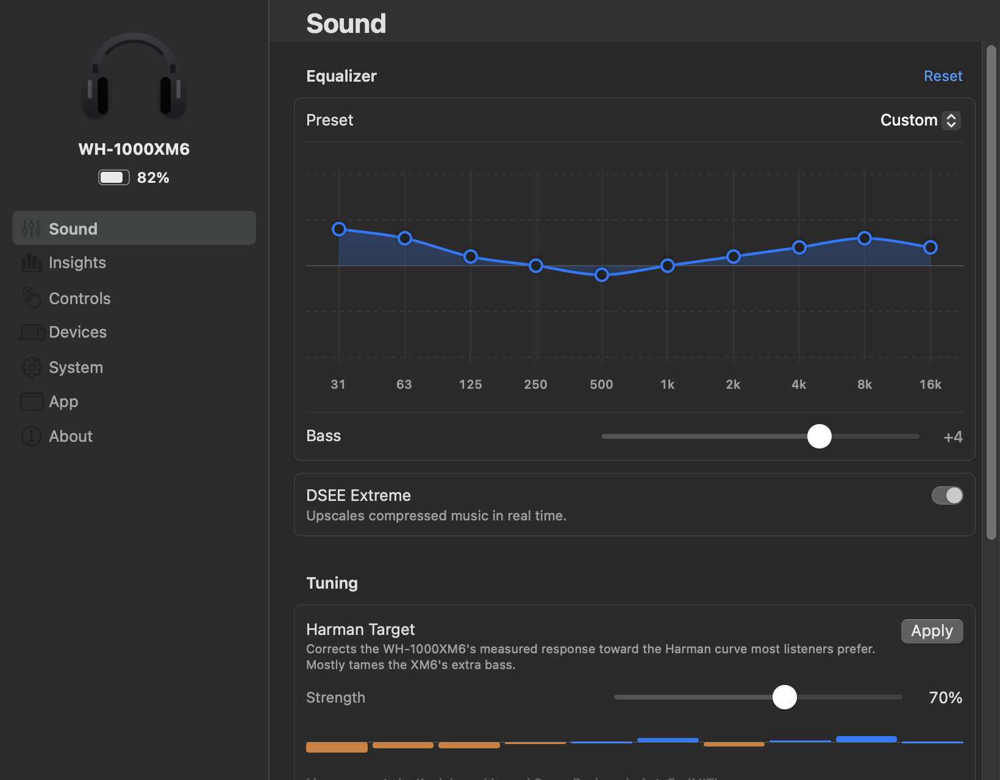
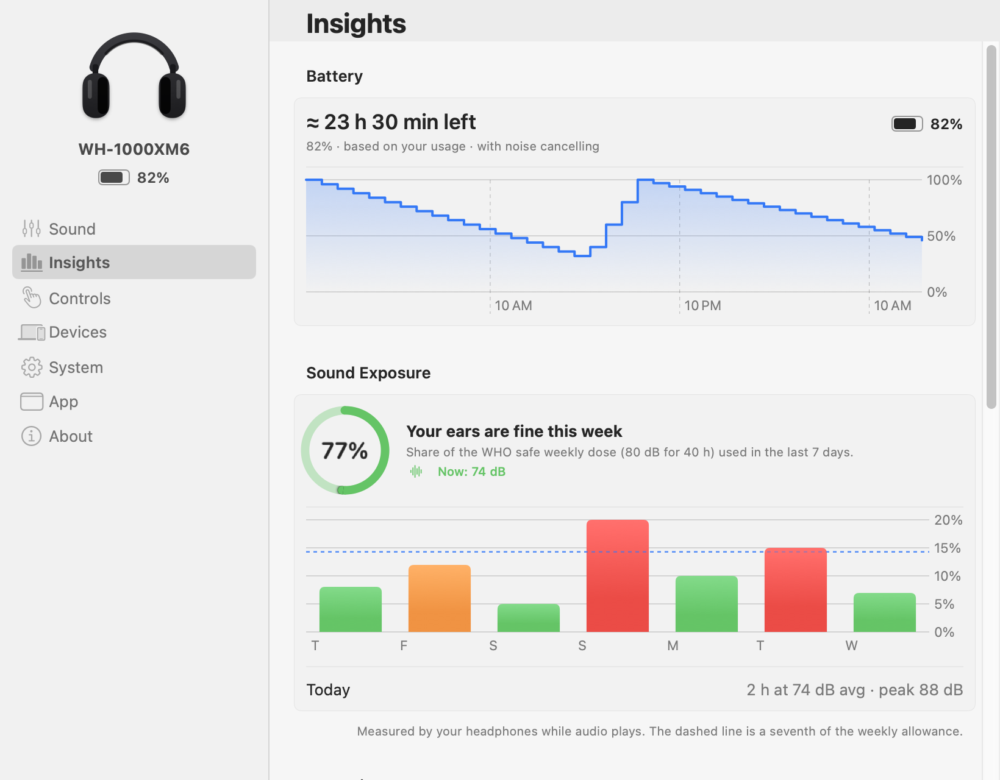
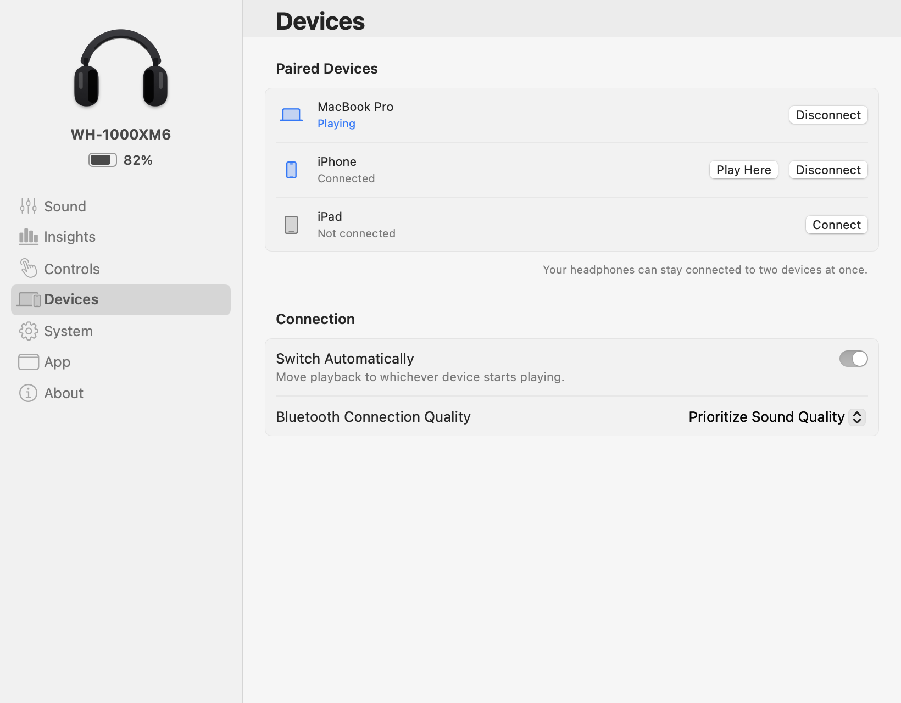
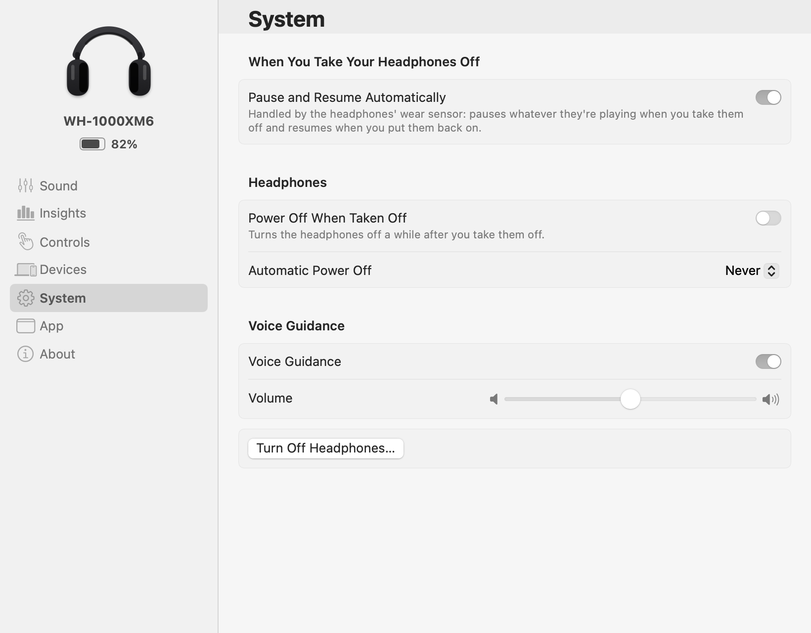

<p align="center">
  
</p>

<h1 align="center">SoundConnect for macOS</h1>

<p align="center">
  A native menu bar app for Sony headphones (WH-1000XM6 and other Sony Sound Connect models), so you can control them from your Mac over Bluetooth. It does more than Sony's mobile app: it knows what your Mac is doing.
</p>

<p align="center">
  
  &nbsp;
  
</p>

## Features

**Everything from Sony's app, on your Mac**
- Noise cancelling / ambient sound / off, ambient level, Focus on Voice, Auto Ambient
- Listening modes: Standard, Background Music (My Room, Living Room, Café), and Cinema
- 10-band EQ with a draggable curve editor, presets, a bass control, and DSEE Extreme
- Speak-to-Chat, NC/AMB button behaviour, head gestures, touch panel, Capture Voice During Calls
- Multipoint: see paired devices; connect, disconnect or move playback to one
- Battery, now playing with track controls, wear detection, voice guidance, auto power off, power off

**Beyond Sony's app**
- **Harman Target**: one-tap correction toward the Harman curve, fitted to the XM6's 10 bands from [AutoEq](https://github.com/jaakkopasanen/AutoEq) measurements, with a strength slider
- **Hearing Test**: a 2-minute tone test that lifts the frequencies you hear less well. It isn't a medical test.
- **Find My Sound**: a blind A/B test you run on your own music. Pick A or B eight times and it converges on the curve you prefer.
- **Sound exposure**: the headphones' own dB measurements, tracked against the WHO safe-listening weekly allowance
- **Battery forecast**: "≈ 14 h left", learned from your actual drain rate, separately with and without NC
- **Wear time** per day, with an optional break reminder
- **Last seen**: when and where your headphones last disconnected, on a map
- **Pause on removal for Mac media**: Music and Spotify are paused directly. The headphones' own auto-pause is respected, so playback is never toggled twice.
- Low-battery notifications, battery % in the menu bar, open at login

<table>
  <tr>
    <td></td>
    <td></td>
  </tr>
  <tr>
    <td align="center">EQ editor, Harman Target, hearing test, A/B finder</td>
    <td align="center">Battery forecast, sound exposure, wear time</td>
  </tr>
  <tr>
    <td></td>
    <td></td>
  </tr>
  <tr>
    <td align="center">Multipoint devices and connection quality</td>
    <td align="center">Wear sensor, power and voice guidance</td>
  </tr>
</table>

Screenshots use sample data.

## Install

1. Download `SoundConnect-x.y.z.zip` from [Releases](../../releases/latest) and unzip it. It's a universal build for Apple Silicon and Intel, macOS 14 or later.
2. Move **SoundConnect.app** to **Applications** and open it.
3. The app isn't notarized by Apple, so the first launch is blocked. Open **System Settings → Privacy & Security** and click **Open Anyway** next to SoundConnect. (Or run `xattr -dr com.apple.quarantine /Applications/SoundConnect.app` in Terminal.)
4. Allow **Bluetooth** when asked. Connect your headphones in Bluetooth settings as usual, and SoundConnect picks them up automatically.

Optional permissions:
- **Notifications**: low-battery and break reminders.
- **Location**: last-seen place.
- **Automation**: pausing Music and Spotify.

## Compatibility

Developed and tested on a **WH-1000XM6** (firmware 3.1.5) running macOS 27. Connections work over either of Sony's two control protocols: v2 (XM5/XM6 era) and v1 (XM3/XM4 era). Every control appears only if the connected headphones report that they support it, so other models should work with the features they have. The protocol library documents support for WH-1000XM3/XM5/XM6, WF-1000XM5/XM6, WH-CH720N, WF-C510, WF-C700N, WF-L910, WF-LC900 and WF-LS900N.

XM6-specific pieces: the Harman Target data, and the spec battery figures the forecast uses until it has learned your usage.

## How it works

```
┌─────────────────────────── SoundConnect.app ───────────────────────────┐
│  SwiftUI views (popover, settings)   ◀─ snapshots ─  HeadphoneStore    │
│  AppKit shell (NSStatusItem/NSPopover,                (main actor)     │
│  NSSplitViewController settings)                        │  writes      │
│                                                         ▼              │
│                                             MDREngine (worker thread)  │
│                                                         │ C ABI        │
├─────────────────────────────────────────────────────────┼──────────────┤
│  vendor/SonyHeadphonesClient: libmdr (protocol) + libmdr-bt (IOBluetooth RFCOMM) │
└──────────────────────────────────────────────────────────────────────────┘
```

- The Sony protocol comes from [mos9527/SonyHeadphonesClient](https://github.com/mos9527/SonyHeadphonesClient) (MIT), vendored as a git submodule. Only its `libmdr` and `libmdr-bt` libraries are used, through their C ABI. The UI here is all new.
- libmdr isn't thread-safe. `MDREngine` makes every libmdr call on one thread and polls at 40 Hz. The UI sends writes as closures and gets back immutable `HeadphoneState` snapshots.
- The menu bar item, popover and settings window are AppKit (`NSStatusItem` + `NSPopover`, `NSSplitViewController`) hosting SwiftUI. SwiftUI's `MenuBarExtra` doesn't resize to dynamic content, and `NavigationSplitView` misaligns its chrome inside a hand-made window.
- Insights history is stored only on your Mac, in `~/Library/Application Support/SoundConnect/history.json`.

## Building

Requirements: Xcode 15+, CMake 3.31+, Ninja (`brew install cmake ninja`).

```sh
git clone --recursive <this repo>
cd soundconnect
scripts/build.sh --run       # builds libmdr + the app into build/SoundConnect.app and launches it
scripts/build.sh --install   # same, then installs to /Applications and launches it from there
scripts/release.sh           # universal, ad-hoc signed dist/SoundConnect-<version>.zip for GitHub releases
```

Notes:
- **Run it as an `.app`.** macOS only delivers IOBluetooth RFCOMM callbacks to bundled apps with a Bluetooth usage description.
- **Signing.** `build.sh` signs with your first "Apple Development" identity (override with `SOUNDCONNECT_SIGN_IDENTITY`), falling back to ad-hoc signing. A stable identity matters: macOS ties the Bluetooth and Accessibility grants to the signature, and an ad-hoc signature changes on every build.
- **Quitting.** The app closes its Bluetooth channel on quit. If a crash leaves the channel reserved, connecting fails instantly. **Reset Connection** in the popover reconnects the headphones to clear it.

### Developer tools

```sh
swift build
.build/debug/SoundConnect --render /tmp/shots        # popover + settings panes, light/dark, sample data
.build/debug/SoundConnect --render-icon /tmp/AppIcon.iconset
defaults write dev.soundconnect.mac debugDump -bool YES   # log every capability the device reports on connect
log stream --info --predicate 'subsystem == "dev.soundconnect.mac"'
```

`tools/probe/` has the original raw RFCOMM probe used to confirm the protocol on the XM6.

## Protocol notes

These were found while building this app and may help others:
- The XM6 exposes the control service `956C7B26-D49A-4BA8-B03F-B17D393CB6E2` (MDR v2) on RFCOMM channel 9.
- **No Clear Bass on the XM6.** It moved to a 10-band EQ (31 Hz–16 kHz, ±6) with no Clear Bass slot. Band edits are only accepted on the Custom and user presets, not on Off or the built-in presets.
- **Sound pressure is only measured with Safe Listening mode on.** Otherwise the reply to `SAFE_LISTENING_GET_EXTENDED_PARAM` (cmd `0x5B`) carries level 0 and error cause `0x03`, which the library doesn't currently decode.
- **Auto-pause goes to the playback device.** The headphones' auto-pause and resume go over AVRCP to whichever multipoint device is currently the playback device, so with a phone as the source the Mac isn't paused.

## Credits

- [SonyHeadphonesClient](https://github.com/mos9527/SonyHeadphonesClient) by mos9527, Amr Satrio and contributors (MIT): protocol implementation
- [AutoEq](https://github.com/jaakkopasanen/AutoEq) by Jaakko Pasanen (MIT), with XM6 measurements by Kuulokenurkka and Super Review: Harman correction data

Not affiliated with or endorsed by Sony. "Sony", "WH-1000XM6" and "Sound Connect" are trademarks of Sony Group Corporation.
